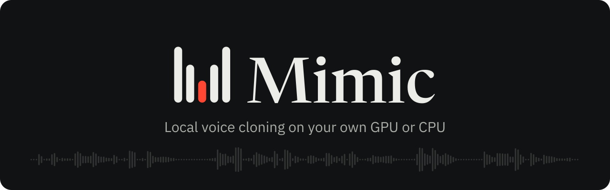
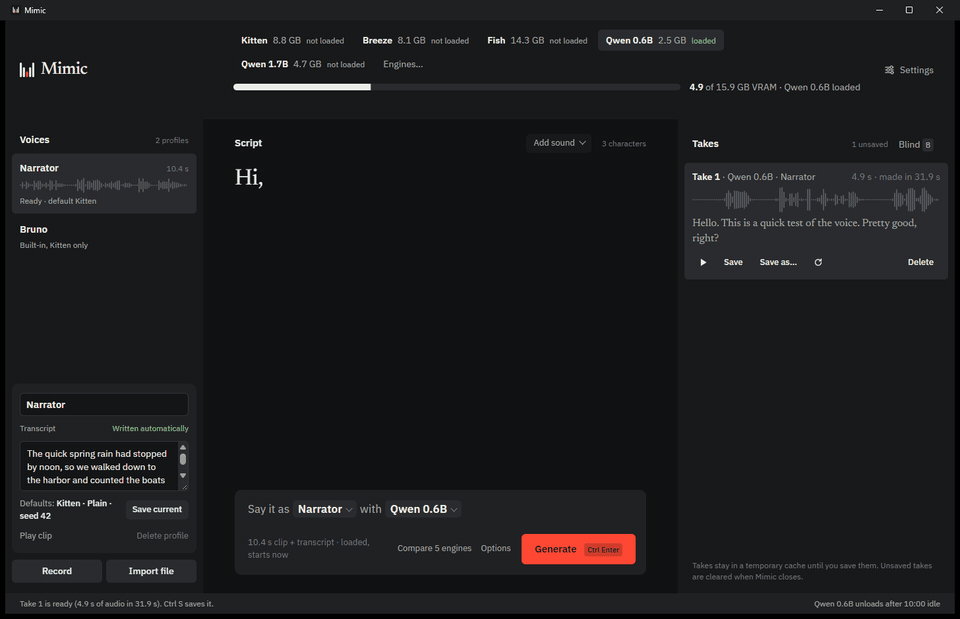
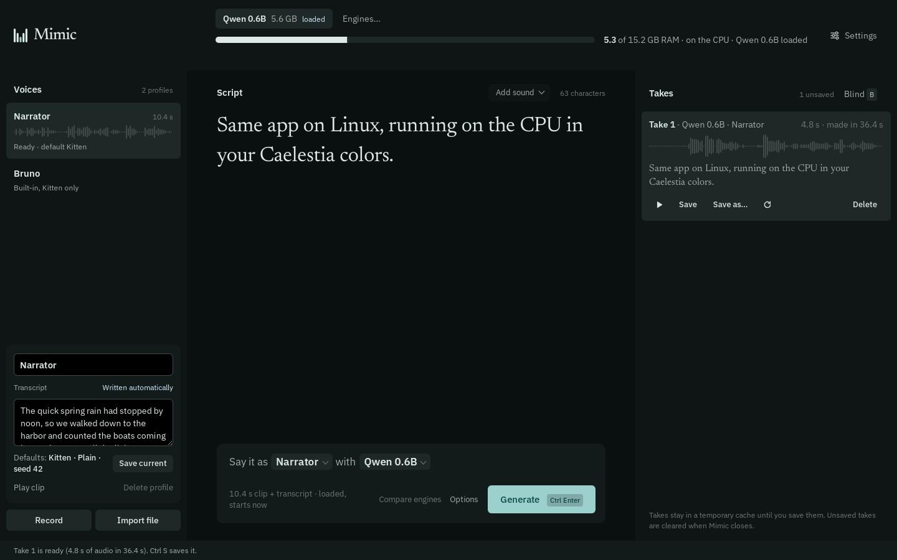
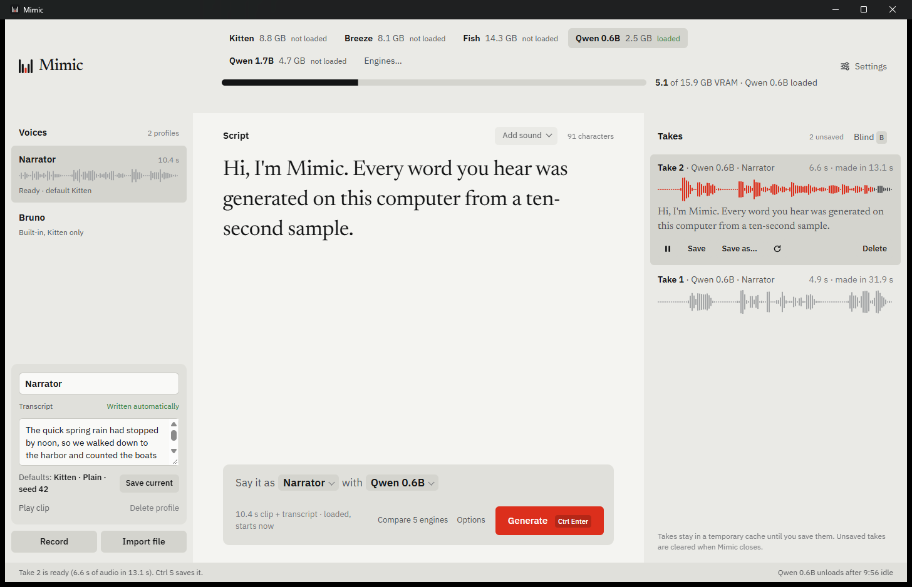
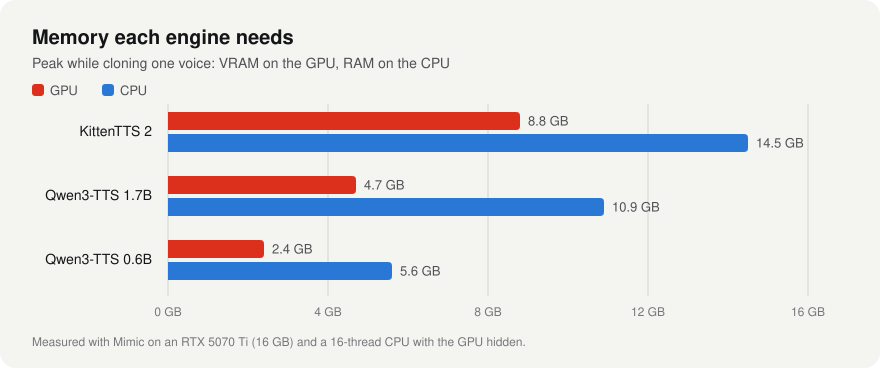
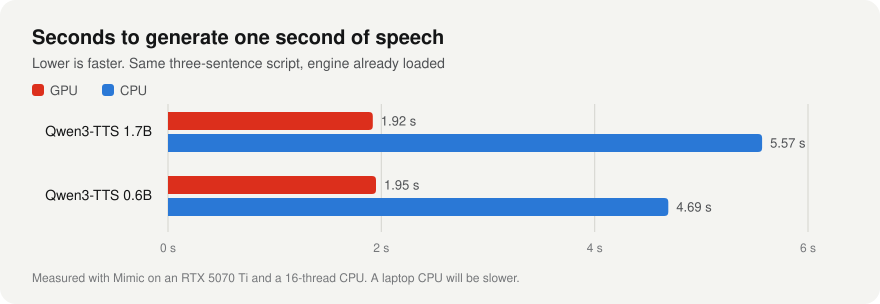
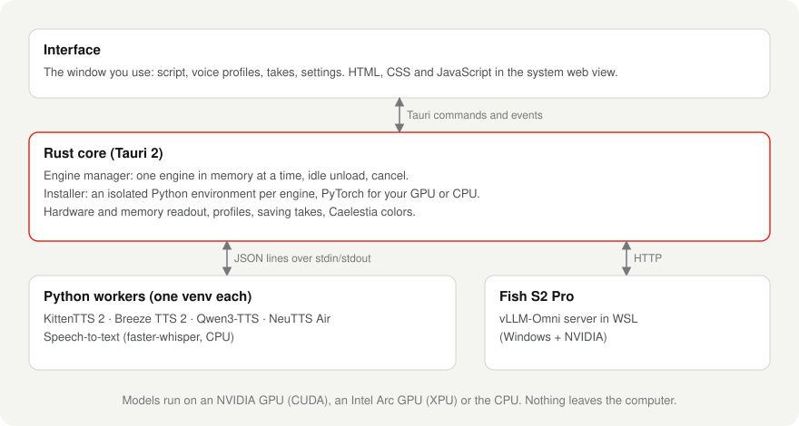

<div align="center">

<picture>
  <source media="(prefers-color-scheme: dark)" srcset="docs/assets/brand/banner-dark.svg">
  <source media="(prefers-color-scheme: light)" srcset="docs/assets/brand/banner-light.svg">
  
</picture>

**Clone a voice from a few seconds of audio and make it say anything.<br>Runs on your own GPU or CPU, on Windows and Linux. Nothing leaves your computer.**

[](https://github.com/Mazon3442/Mimic/releases)
[](LICENSE)
[](#install)
[](https://tauri.app)

[Features](#features) · [Install](#install) · [Quick start](#quick-start) · [Engines](#engines) · [How it works](#how-it-works) · [Build from source](#build-from-source)

<br>



<sub>A real recording at real speed: Qwen3-TTS 0.6B cloning a demo voice on an RTX 5070 Ti.</sub>

</div>

## Features

| Feature | What it does |
| --- | --- |
| **Voice profiles** | Record a voice by reading a short passage, import a clip, or drop audio files onto the window. Each profile keeps its clip, transcript and favorite settings. |
| **Automatic transcripts** | Clips are transcribed on your machine with faster-whisper, so engines that need the exact words get them without typing. |
| **Nine engines, one window** | KittenTTS 2, Breeze TTS 2, Fish S2 Pro, Qwen3-TTS 0.6B and 1.7B, Chatterbox Turbo, VoxCPM2, Audio8 TTS Preview, and NeuTTS Air (Linux). Download, remove and pin them from Settings › Engines. |
| **GPU or CPU** | Mimic detects the hardware and runs models on an NVIDIA GPU, an AMD Radeon GPU on Linux (ROCm, experimental), an Intel Arc GPU (experimental) or the CPU. If a driver or runtime is missing, it says which package to install for your distro. The bar at the top shows real VRAM or RAM use. |
| **One engine in memory** | Switching engines unloads the old one first, and idle engines unload after a set time, so the GPU is free for everything else. |
| **Nothing saved behind your back** | Takes stay in a temporary cache until you press Save (Ctrl+S) or Save as (Ctrl+Shift+S). WAV, FLAC or MP3. |
| **Compare engines** | Generate the same line with every engine that fits, optionally blind, and keep the best take. |
| **At home on Linux** | Native on Wayland and X11. With [Caelestia](https://github.com/caelestia-dots/shell), Mimic follows your shell's live colors; on Hyprland it drops the title bar. |

<table>
  <tr>
    <td width="50%"></td>
    <td width="50%"></td>
  </tr>
  <tr>
    <td align="center"><sub>Linux, CPU only, Caelestia colors</sub></td>
    <td align="center"><sub>Light theme</sub></td>
  </tr>
</table>

## Install

| Platform | Download |
| --- | --- |
| **Windows 10/11** | `Mimic_<version>_x64-setup.exe` from [Releases](https://github.com/Mazon3442/Mimic/releases) |
| **Debian / Ubuntu** | `.deb` from Releases, then `sudo apt install ./Mimic_<version>_amd64.deb` |
| **Fedora** | `.rpm` from Releases |
| **Any Linux** | `.AppImage` from Releases |
| **Arch Linux** | `cd packaging/arch && makepkg -si` (builds the release set in `pkgver`) |

Mimic also needs two command-line tools: **[uv](https://docs.astral.sh/uv/)** to download engines, and **ffmpeg** to import and convert audio.

```bash
winget install astral-sh.uv                               # Windows
winget install Gyan.FFmpeg
sudo pacman -S --needed uv ffmpeg pciutils xdg-user-dirs  # Arch
```

## Quick start

1. Open **Settings › Engines** and download an engine that fits your PC. *Qwen3-TTS 0.6B* is a good first pick: about 2.5 GB of VRAM, or about 6 GB of RAM on the CPU.
2. Download **speech-to-text** from the same list, so transcripts write themselves.
3. Press **Record** and read the passage, or drop a 3–30 second clip of one speaker onto the window.
4. Type a script, press **Ctrl+Enter**, then **Space** to listen and **Ctrl+S** to keep the take.

Only clone voices you have permission to use.

## Engines

| Engine | Runs on | Memory | Clones from | Get it | License |
| --- | --- | --- | --- | --- | --- |
| **Qwen3-TTS 0.6B** | GPU or CPU | 2.4 GB VRAM · 5.6 GB RAM | clip + transcript | Download in Mimic | Apache 2.0 |
| **Qwen3-TTS 1.7B** | GPU or CPU | 4.7 GB VRAM · 10.9 GB RAM | clip + transcript | Download in Mimic | Apache 2.0 |
| **Chatterbox Turbo** | GPU or CPU | 3.4 GB VRAM · 6.0 GB RAM | clip only (over 5 s) | Download in Mimic | MIT |
| **VoxCPM2** | NVIDIA GPU | 6.9 GB VRAM | clip + transcript | Download in Mimic | Apache 2.0 |
| **Audio8 TTS Preview 0.6B** | GPU or CPU | 3.6 GB VRAM · 6.1 GB RAM | clip + transcript | Download in Mimic | Apache 2.0 |
| **KittenTTS 2** | GPU (CPU possible) | 8.8 GB VRAM · 14.5 GB RAM | clip only | Download in Mimic | Stellon Labs Community |
| **NeuTTS Air** | CPU (Linux) | about 1 GB RAM¹ | clip (3–15 s) + transcript | Download in Mimic, needs a free Hugging Face account | Apache 2.0 |
| **Breeze TTS 2** | NVIDIA GPU | about 8 GB VRAM¹ | clip + transcript | Set up by hand | Non-commercial |
| **Fish S2 Pro** | NVIDIA GPU, Windows (WSL) | about 15 GB VRAM¹ | clip + transcript | Set up by hand | See model card |

<sub>Qwen, Kitten, Chatterbox, VoxCPM2 and Audio8 figures were measured with Mimic (peak while cloning, RTX 5070 Ti / 16-thread CPU). ¹ Published or setup-note figures, not yet measured with Mimic.</sub>

<div align="center">
<picture>
  <source media="(prefers-color-scheme: dark)" srcset="docs/assets/charts/memory-dark.svg">
  
</picture>
<br><br>
<picture>
  <source media="(prefers-color-scheme: dark)" srcset="docs/assets/charts/speed-dark.svg">
  
</picture>
</div>

## How it works

<div align="center">
<picture>
  <source media="(prefers-color-scheme: dark)" srcset="docs/assets/charts/architecture-dark.svg">
  
</picture>
</div>

Each engine lives in its own Python environment, so their dependencies never collide. The Rust core keeps one engine in memory at a time, and puts every engine process in a job (Windows) or process group (Linux) that ends with Mimic. Even a crash can't leave a model holding your VRAM.

<details>
<summary><b>Linux, Caelestia and Hyprland</b></summary>

- **Caelestia:** when `~/.local/state/caelestia/scheme.json` exists, the Theme setting defaults to *Caelestia*, and Mimic re-colors itself when the scheme changes with your wallpaper.
- **Hyprland:** the window has no GTK title bar, because Hyprland draws its own borders. Its window class is `mimic`, for window rules.
- **Where models run:** Settings › Run engines on. *Automatic* picks CUDA on NVIDIA, ROCm on AMD Radeon cards, XPU on Intel Arc-class graphics (Arc cards, Core Ultra), and the CPU otherwise. GPUs are found by PCI id from sysfs, so this works the same on any distro, with or without `lspci` or `nvidia-smi`.
  - **AMD (experimental):** ROCm's PyTorch ships its own libraries, so the kernel's `amdgpu` driver is all you need, plus access to `/dev/kfd` (`sudo usermod -aG render,video $USER`, then log in again; Mimic tells you if it's missing). Cards ROCm doesn't list officially, like the RX 6600/6700, run in compatibility mode. Radeon integrated graphics (680M, 780M, 890M) run only when you choose *GPU*, because they share system RAM.
  - **Intel Arc:** needs Intel's compute runtime (Level Zero). Mimic shows the package for Arch, Debian/Ubuntu or Fedora if it's missing.
  - **NVIDIA:** needs NVIDIA's own driver; with nouveau, Mimic uses the CPU and says how to install it.
  - **Not supported:** older Intel graphics (Iris Xe, UHD), because PyTorch doesn't support them, and most Radeon cards older than the RX 6000 series. Those PCs use the CPU.
  - After changing the setting, **Settings › Engines** offers each downloaded engine's build for the new choice (*Get AMD GPU build*).
- **Files:** engines and models live in `~/.local/share/mimic/engines`; profiles, clips and settings in `~/.local/share/com.mazon.mimic`.
- **NVIDIA on Wayland:** Mimic sets `WEBKIT_DISABLE_DMABUF_RENDERER=1` by itself to avoid WebKitGTK's blank-window bug.

</details>

<details>
<summary><b>NeuTTS Air and Hugging Face</b></summary>

NeuTTS Air is the engine for older laptops: it runs on the CPU in about 1 GB of RAM. Its models are gated on Hugging Face (free, instant approval):

1. Sign in at [huggingface.co](https://huggingface.co) and accept the terms on [neutts-air-q4-gguf](https://huggingface.co/neuphonic/neutts-air-q4-gguf) and [neucodec](https://huggingface.co/neuphonic/neucodec).
2. Create a **read** token under Settings › Access Tokens.
3. Paste it in Mimic under **Settings › Engines and memory**. It stays on your computer.
4. Install the build tools NeuTTS compiles with: `sudo pacman -S --needed espeak-ng cmake base-devel`.

</details>

<details>
<summary><b>Engines folder and command-line downloads</b></summary>

Engines, their Python environments and model files live in one folder (Settings › Engines folder):

| | Default |
| --- | --- |
| Windows | `%USERPROFILE%\tts` |
| Linux | `~/.local/share/mimic/engines` |

```text
qwen-env/   models/Qwen3-TTS-12Hz-0.6B-Base/   models/Qwen3-TTS-12Hz-1.7B-Base/
kitten-env/ models/kitten-tts-2/
chatterbox-env/ models/chatterbox-turbo/
voxcpm-env/ models/VoxCPM2/
audio8-env/ models/Audio8-TTS-Preview-0.6b/
neutts-env/
stt-env/
```

Engines can be downloaded without opening the window:

```bash
mimic --install qwen06      # also: qwen17, kitten, chatterbox, voxcpm, audio8, neutts, stt
```

Breeze TTS 2 and Fish S2 Pro are set up by hand: `breeze-env/`, `models/breeze-tts-2/` and the `breeze-tts/` repo for Breeze, and `scripts/setup-vllm-wsl.sh` in WSL Ubuntu 24.04 for Fish (set `FISH_WEIGHTS` to the folder holding the weights).

</details>

<details>
<summary><b>Keyboard shortcuts</b></summary>

| Action | Keys |
| --- | --- |
| Generate | Ctrl+Enter |
| Play or pause the selected take | Space |
| Save take / Save as | Ctrl+S / Ctrl+Shift+S |
| Jump between takes | 1–9, J, K |
| Blind comparison | B |
| Stop playback or cancel a take | Esc |
| Command palette | Ctrl+K |
| Settings | Ctrl+, |

</details>

## Build from source

Needs Rust (stable) and Node.js. On Windows, also the Microsoft C++ Build Tools. On Linux, WebKitGTK 4.1:

```bash
sudo pacman -S --needed webkit2gtk-4.1 base-devel rust nodejs npm   # Arch
sudo apt install build-essential pkg-config libssl-dev libxdo-dev libwebkit2gtk-4.1-dev \
  libayatana-appindicator3-dev librsvg2-dev nodejs npm                 # Debian / Ubuntu
```

```bash
cd app/src-tauri
cargo run                                # development build
npx @tauri-apps/cli@2 build              # Windows installer in target/release/bundle/nsis
npx @tauri-apps/cli@2 build --bundles deb,rpm,appimage   # Linux packages
```

Releases come from GitHub Actions: push an annotated tag such as `v1.2.0` and `.github/workflows/release.yml` builds the Windows installer and the Linux `.deb`, `.rpm` and AppImage, signs them and publishes one release with a `latest.json`. Installed copies check that file on start and offer the update (Settings › About too). Signing needs the repository secret `TAURI_SIGNING_PRIVATE_KEY`, the private half of the `pubkey` in `tauri.conf.json`. Arch builds from the PKGBUILD are told about new versions but update through `makepkg`.

<details>
<summary><b>Repository layout</b></summary>

```text
app/ui/             interface (HTML, CSS, JS; fonts bundled)
app/src-tauri/      Rust core: engine manager, installer, hardware, profiles, saving
engines/            Python workers, one per engine
scripts/            WSL scripts for the Fish S2 Pro server
packaging/arch/     PKGBUILD
docs/               design notes and README assets
design/             the clickable design mockup
tui/, tts-tui.py    the original terminal app (superseded by app/)
```

</details>

<details>
<summary><b>Testing hooks</b></summary>

- `MIMIC_TEST="import:/path/clip.wav;engine:qwen06;generate;save"` runs steps inside the app and logs them to `logs/ui.log`. The window opens without taking focus.
- `MIMIC_DATA_DIR=<folder inside the app data folder>` uses a separate set of profiles, settings and takes.

</details>

## License

Mimic's code is released under the [MIT License](LICENSE). No model weights are included. Each engine has its own license, so check it before any commercial use.

<div align="center">
<br>

</div>
